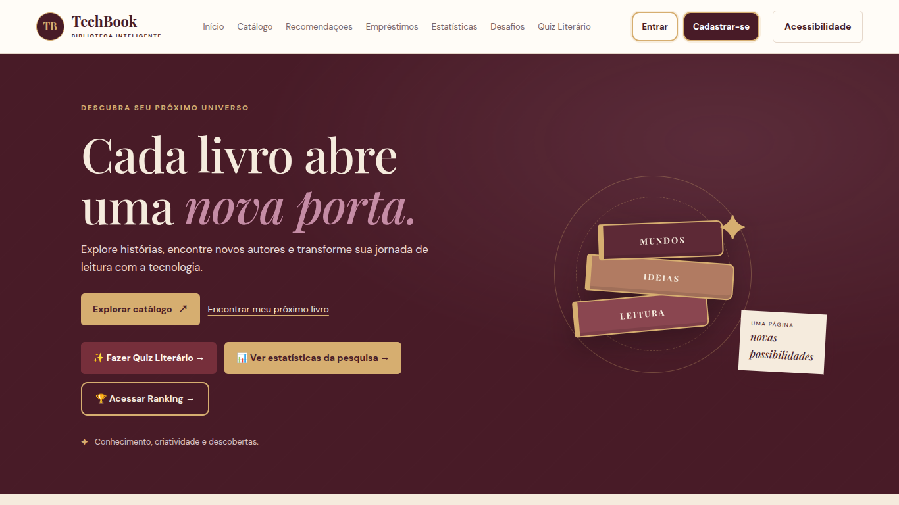
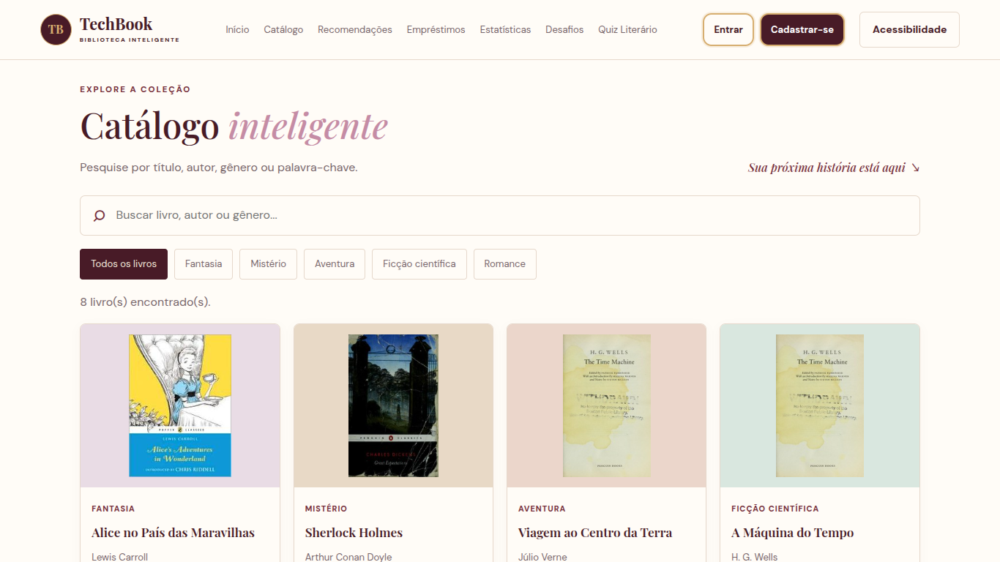
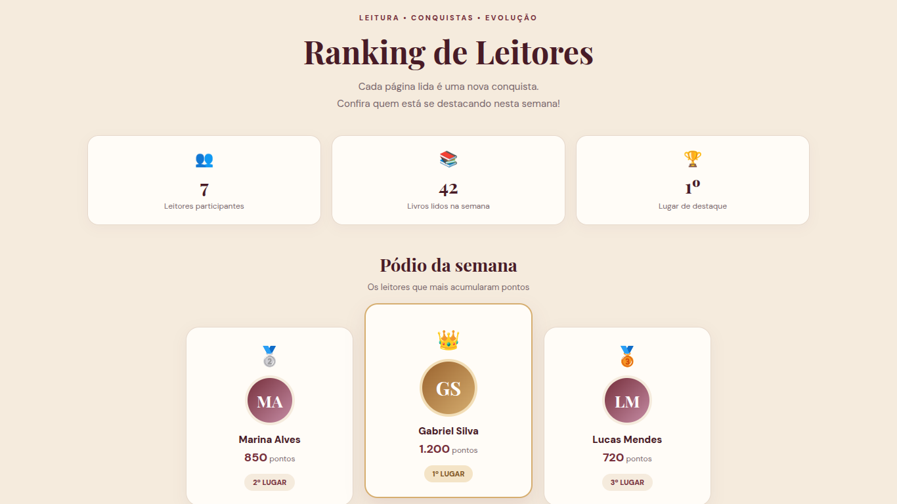
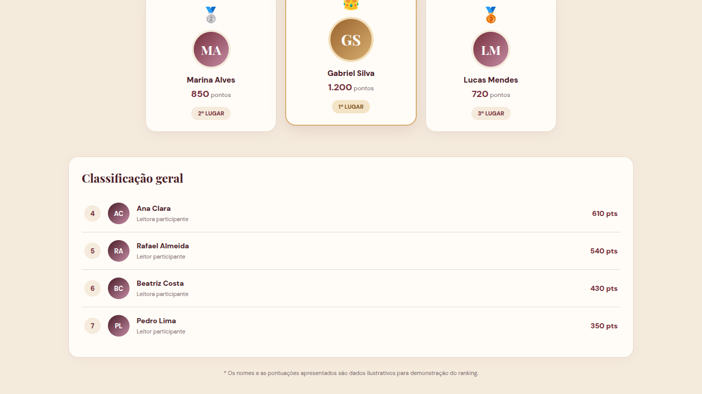
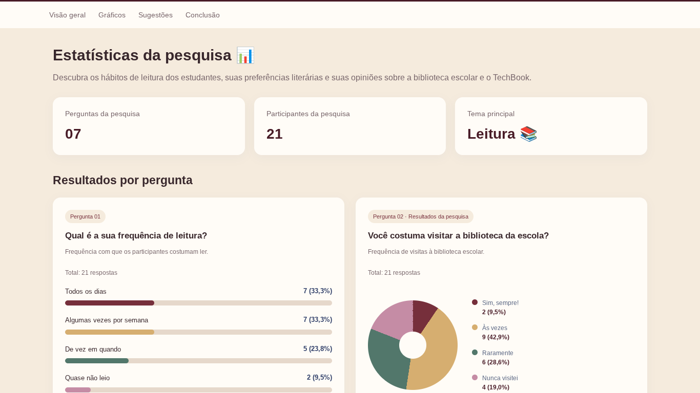
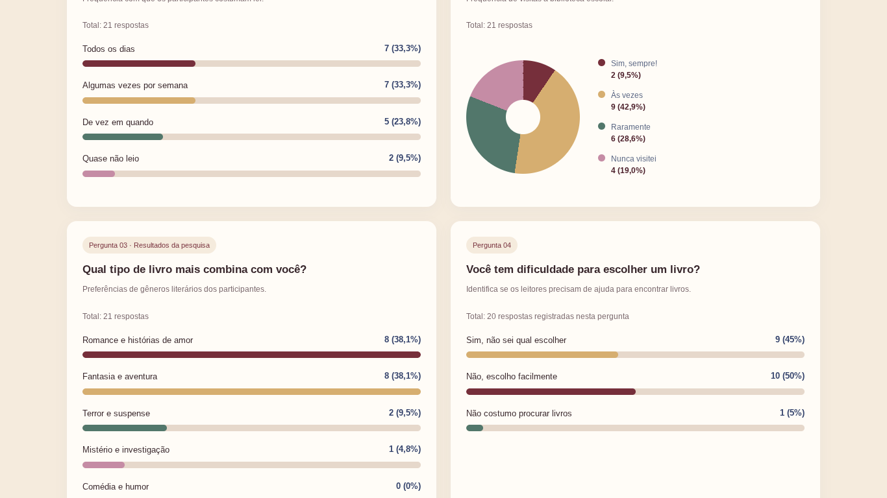
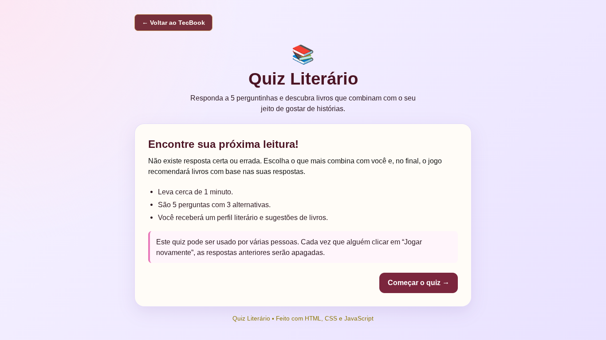
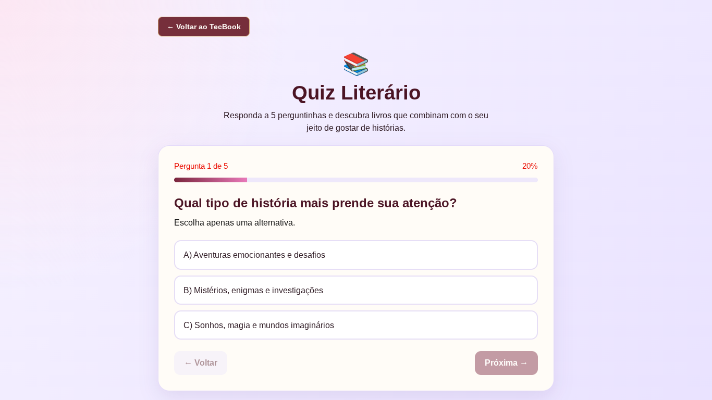

 

# TECHBOOK
### BIBLIOTECA INTELIGENTE

**Tecnologia, conhecimento e leitura em um só lugar.**

---

> 🚧 **Projeto em desenvolvimento:** novas funcionalidades, integrações e melhorias estão sendo implementadas.

## 📖 Sobre o projeto

O **TechBook** é uma plataforma de biblioteca inteligente desenvolvida para facilitar a organização do acervo literário, incentivar o hábito da leitura e tornar a experiência dos leitores mais interativa e acessível.

O sistema reúne funcionalidades para explorar livros, acompanhar o progresso de leitura, participar de desafios literários e descobrir novas obras por meio de recomendações.

### 🎯 Objetivo

Desenvolver uma plataforma digital intuitiva e interativa para auxiliar na gestão de uma biblioteca escolar e incentivar a leitura entre os estudantes.

### 🏫 Contexto do projeto

O TechBook foi desenvolvido como um projeto para a **Feira de Ciências**, na área de tecnologia, pelos estudantes do 2º ano do curso técnico em Desenvolvimento de Sistemas.

A proposta é demonstrar como a programação pode ser aplicada à realidade escolar, unindo inovação, educação e incentivo à leitura por meio de uma biblioteca digital inteligente.

---

## 🖥️ Conheça o sistema

### 🏠 Página inicial

A página inicial apresenta a identidade visual do TechBook e reúne os principais acessos e recursos da plataforma.

### 📚 Catálogo de livros

O catálogo permite explorar os livros disponíveis na biblioteca, com apresentação visual das obras.

### 🏆 Ranking de leitores

A classificação apresenta os leitores participantes e suas pontuações, incentivando a participação e o hábito da leitura.

<table>
<tr>
<td width="50%">

</td>
<td width="50%">

</td>
</tr>
</table>

### 📊 Estatísticas

O painel apresenta informações sobre a leitura e os dados da biblioteca por meio de recursos visuais.

<table>
<tr>
<td width="50%">

</td>
<td width="50%">

</td>
</tr>
</table>

### 🧩 Quiz literário

O quiz oferece uma experiência interativa com perguntas relacionadas à literatura.

<table>
<tr>
<td width="50%">

</td>
<td width="50%">

</td>
</tr>
</table>

---

## ✨ Funcionalidades

| Recurso | Descrição |
|---|---|
| 📚 **Catálogo inteligente** | Consulta e exploração dos livros disponíveis. |
| 🔄 **Empréstimos e devoluções** | Apoio à organização da circulação dos livros. |
| 💡 **Recomendador de leituras** | Sugestões para descobrir novas obras. |
| 📊 **Estatísticas** | Acompanhamento de dados e progresso de leitura. |
| 🏆 **Ranking semanal** | Classificação dos leitores. |
| 🎯 **Desafios literários** | Atividades para incentivar a leitura. |
| 🧩 **Quiz literário** | Perguntas interativas relacionadas à literatura. |
| ♿ **Acessibilidade digital** | Recursos para tornar a navegação mais acessível. |
| 🧠 **Medidor de leitura** | Recurso visual relacionado à leitura, aprendizagem e desenvolvimento cognitivo. |
| 🖼️ **Catálogo com imagens** | Apresentação visual das capas dos livros. |

## 🛠️ Tecnologias utilizadas

- **HTML5:** estrutura das páginas.
- **CSS3:** aparência e organização visual.
- **JavaScript:** interatividade e funcionalidades.
- **Python:** servidor utilizado no projeto.
- **SQLite:** armazenamento de dados.
- **Git e GitHub:** controle de versões e colaboração.
- **GitHub Codespaces:** ambiente de desenvolvimento.
- **Visual Studio Code:** editor de código.

---

## ⚙️ Instalação e uso

O TechBook está sendo desenvolvido para acesso pela web, utilizando o GitHub Codespaces durante o desenvolvimento.

Para executar o projeto no ambiente de desenvolvimento:

1. Acesse o repositório do TechBook no GitHub.
2. Abra o projeto no GitHub Codespaces.
3. Inicie o servidor configurado para o projeto.
4. Acesse o endereço disponibilizado pelo Codespaces.
5. Utilize as funcionalidades disponíveis na interface.

A execução local e o funcionamento sem conexão com a internet dependem da configuração do servidor, do armazenamento de dados e do cache das páginas.

## 🌱 Impacto esperado

O TechBook pretende contribuir para a modernização da biblioteca escolar, incentivando o hábito da leitura e aproximando os estudantes da tecnologia.

Por meio de recursos interativos, acessibilidade e acompanhamento do progresso, o projeto busca tornar a leitura uma experiência mais organizada, dinâmica e estimulante.

---

## 👥 Desenvolvedores

Projeto desenvolvido pelos estudantes do **2º Ano TEC — Desenvolvimento de Sistemas**.

| Integrante | Integrante |
|---|---|
| Jessia | Esther |
| Yasmin | Fernanda |
| Giovanna | Ana Maria |
| Emilly | Álvaro |

**Instituição:** SENAI  
**Ano:** 2026  
**Projeto:** Feira de Ciências — Área de Tecnologia

---

# TECHBOOK

**Uma biblioteca inteligente para transformar sua relação com a leitura.**

*Feira de Ciências • SENAI • 2026*

